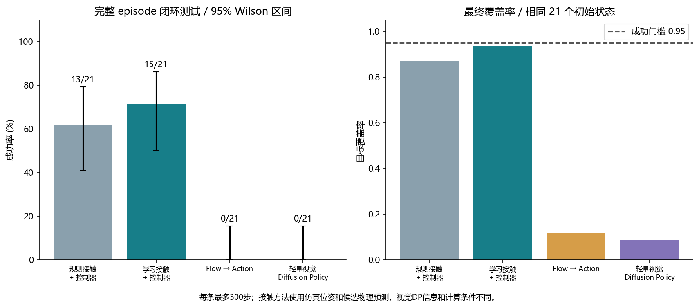

# Flow → Contact：从物体运动到接触

一个在 **二维 PushT 仿真**中完成数据核验、接触模型训练、独立控制器和对照评测的课程研究项目。给定 T 形物体当前几何及期望短期运动，模型为固定编号的轮廓点打分，再由控制器安排接近路径与推动动作。

本次仓库整理用于私有 GitHub 协作，不为自写代码另行声明开源许可。第三方来源与许可见 [THIRD_PARTY_NOTICES.md](THIRD_PARTY_NOTICES.md)。

**阶段 1–4 已实际运行，结果与失败均保留。** 当前实现尚未证明跨机器人本体、真实机器人或三维任务的泛化。“跨本体”是研究方向，不是本轮已经取得的结论。

第一次了解项目，建议先读 **[项目详解：原本要完成什么，最终实现了什么](docs/PROJECT_GOALS_AND_RESULTS.md)**。它逐项对照四阶段要求，解释 flow、接触模型与控制器的分工、真实结果、墙体限制，以及尚未完成的跨本体研究。

```text
当前物体状态 + 目标
        ↓
规划 8 步期望物体 flow
        ↓
64 个轮廓点的接触分数
        ↓
独立控制器：接近路径 + 短推 + 物理候选预测
        ↓
仿真执行，获取新状态，再规划
```

flow 是物体材料点相对当前帧的位移，不是推杆动作；接触分数也不是最优接触或成功概率。

## 已运行的结果

固定完整示范划分为 **164 / 21 / 21** 条训练、验证、测试。闭环四方法使用相同 21 个初始条件，每条最多 300 次真实控制动作（10 Hz）；覆盖率达到 0.95 记成功。覆盖率是物体与目标的相交面积除以目标面积，**不是 IoU**。

| 方法 | 输入与额外计算 | 成功数 | 成功率 | 平均最终覆盖率 |
|---|---|---:|---:|---:|
| 规则接触 + 独立控制器 | 仿真物体位姿、目标、候选物理预测 | 13/21 | 61.90% | 0.8712 |
| 学习接触 + 同一控制器，主种子 0 | 仿真物体位姿、规划 flow、候选物理预测 | 15/21 | 71.43% | 0.9375 |
| Flow → action | 仿真物体位姿、规划 flow，直接预测动作 | 0/21 | 0.00% | 0.1172 |
| 轻量视觉 Diffusion Policy | 两帧 RGB 与实际推杆位置，生成动作序列 | 0/21 | 0.00% | 0.0869 |

学习接触主模型与规则成功率的配对检验 p=0.625，**不能宣称成功率显著提升**。接触模型三个训练种子的成功数是 15、12、15，均值 66.67%，样本标准差 8.25 个百分点；仍是同一组 21 个场景，不是 63 个独立测试。

主试验后的无 flow 补充诊断为 6/21；它帮助分析 flow 的作用，但不替换预先固定的主模型。视觉 DP 使用官方 U-Net 源码的轻量适配，未复现原论文的完整网络和训练预算。四方法真实动作预算相同，**输入信息和计算预算不同**；两个 0/21 仅描述本轮具体基线，不代表整个方法类别不可行。



- [同一场景的四方法动画](artifacts/stages234/figures/comparison_episode_12.gif)
- [第二至四阶段实验报告 PDF](artifacts/stages234/report.pdf)与[前期工作报告 PDF](artifacts/stage1/report.pdf)
- [实验导航、详细命令与证据](docs/EXPERIMENT_INDEX.md)
- [另一台 Windows 电脑的复现主入口](docs/REPRODUCING.md)
- [实验协议](docs/STAGES234_PROTOCOL.md)与[失败分析](docs/STAGES234_LIMITATIONS_AND_FAILURES.md)
- [完整统计记录](artifacts/stages234/statistical_analysis.json)
- [私有仓库发布页与模型/证据附件](https://github.com/Nogeomos/flow-contact-pusht/releases/tag/v1.0.0-experiments)

## 四个阶段完成了什么

| 阶段 | 已验证内容 | 关键结果 |
|---|---|---|
| 1：环境、示范回放、标签、简单推动 | 原生 Windows；重新执行 3 条完整示范；固定编号轮廓点与子步接触；确定性短推 | 420 帧回放可见掩码平均 IoU 0.957751；简单推动 70 步，两个新进程的全部数据数组相同 |
| 2：训练数据与模型 | 全部 206 条示范重新审计；接触与动作模型训练；32/64/128 点、软硬标签、终点/序列/GRU/无 flow 消融 | 主模型在有接触离线窗口中的 top-1 距离不超过 10 单位比例 93.92%；这不是闭环成功率 |
| 3：闭环控制 | 当前状态与目标生成 flow；学习/规则共用控制器；真实物理执行；控制器冻结后测试 | 主模型 15/21，规则 13/21；测试时不读取示范未来 |
| 4：对照、统计与失败分析 | Flow → action、轻量视觉 DP；完整失败案例；按 episode 统计与独立复验 | 四方法对照、三个接触训练种子、补充无 flow 诊断和新进程验收均已保存 |

全部 206 条示范包含 25,650 帧，重建 119,158 条物理子步接触点记录。训练窗口共 24,000 个（19,130 / 2,589 / 2,281），按完整示范先划分再切窗，避免相邻窗口泄漏。全量回放的可见掩码平均 IoU 约 0.9608；不要与第一阶段重新验收的 3 条子集数值混用。

物体位姿与接触是固定仿真器回放重建结果，原始数据没有直接提供这些字段。标签表示示范中发生的接触，没有独立接触真值，也没有标为最优策略。

## 运行环境与第一次运行

本项目已在 Windows 11、Python 3.12.14 上运行。保留两个独立 Python 环境：

| 环境 | 用途 | 已验证的关键版本 |
|---|---|---|
| `.venv` | 下载、数据核验、回放与基础物理演示；不需要 GPU | NumPy 1.26.4、Gymnasium 0.29.1、Pymunk 6.6.0 |
| `.venv-train` | 接触/动作/视觉模型训练与评测；支持 CPU 推理 | PyTorch 2.7.1+cu126、diffusers 0.35.1、einops 0.8.1 |

原实验 GPU 为 RTX 4060 Laptop 8 GB；它不是运行数据流程的必要条件。没有 NVIDIA GPU 时使用 CPU 版本的 PyTorch，不照搬 CUDA 锁文件。另一台设备请优先使用[复现主入口](docs/REPRODUCING.md)中的安装与恢复脚本；历史环境与实验命令补充见[实验导航](docs/EXPERIMENT_INDEX.md#环境与复现步骤)。

发布准备已在独立暂存目录、新进程中验证资源恢复、206 条回放重建、真实模型 CPU 短程闭环等流程，见[移植检查记录](artifacts/portability/verification.json)。这次复用了已安装的依赖，没有在第二台电脑实测，也没有重新安装独立 CPU wheel；它不等于完成了全新机器安装验证。

克隆仓库后在其根目录打开 PowerShell。以下命令无需激活脚本或更改系统执行策略：

```powershell
py -3.12 -m venv .venv
.\.venv\Scripts\python.exe -m pip install -r requirements-data.lock.txt
.\.venv\Scripts\python.exe -m pip check

$run = 'runs/first_run_' + (Get-Date -Format 'yyyyMMdd_HHmmss')
.\.venv\Scripts\python.exe scripts/prepare_resources.py --output-dir "$run/resources"
.\.venv\Scripts\python.exe scripts/simple_push.py --output-dir "$run/simple_push"
```

资源准备会下载清单固定版本的数据和上游源码，并校验大小与 SHA256；已有文件不匹配时停止，不覆盖。生成动画在新目录 `simple_push/simple_push.gif`。要完成第一阶段完整验收，再运行：

```powershell
.\.venv\Scripts\python.exe scripts/run_stage1.py --offline
```

网络仅用于获取缺失资源；脚本与数据均已在原生 Windows 验证。本轮没有更改驱动、系统 CUDA 或 WSL 配置。更详细的从头训练、离线评估及闭环命令见[实验导航](docs/EXPERIMENT_INDEX.md)。

## 墙体与推杆：当前实现的明确限制

推杆是有碰撞形状的半径 15 圆，必须接触物体才能推它。动作给出绝对目标坐标，PD 控制连续追踪；不是把物体远程移动，也不是每帧将推杆瞬移到目标。

但是推杆采用 **kinematic（运动学）刚体**：它不受碰撞反冲，静态墙不能自动阻挡它。当前没有机械臂关节、臂杆、工作空间或力矩限制。物体本身是动态刚体，会与墙发生碰撞。

接触模型没有显式墙几何或净空特征，但有绝对物体和推杆坐标；期望 flow 也没有经过墙碰撞可行性投影。控制器对 T 形物体做路径避障，并将部分候选与动作限制在 `21..491`；这**不是严格墙体安全约束**。墙内面是 7 与 504，半径 15 的推杆圆心至少应在 `22..489`，还需考虑跟踪误差与额外安全裕量。

原测试保存的 10 Hz 状态中，规则与主接触方法未观察到侵墙；Flow → action 的第 102 条场景有 37 个侵墙状态，最大侵入约 9.95 单位。仅检查这些保存帧不能保证所有物理子步安全。

主试验后，两例冻结模型补充诊断中：左墙场景 261 步成功，覆盖率 0.9570；左上角场景离开墙角但 300 步终态覆盖率 0.9147，仍按失败处理。这两例不是墙角基准，也不增加原测试成功数。代码、权重和主实验没有据此修改。见[墙体诊断](artifacts/wall_diagnostics/summary.json)与[帧级净空审计](artifacts/wall_diagnostics/original_rollout_clearance_audit.json)。

## 仓库组织与公开资源

| 目录/文件 | 内容 |
|---|---|
| `scripts/` | 第一阶段下载、检查、回放、标签可视化、简单推动 |
| `research/` | 模型、训练、控制器、闭环评测、统计与验收 |
| `docs/` | 协议、字段说明、失败分析、实验导航；`archive/` 保留历史 README |
| `artifacts/` | 精选发布结果与证据；不等于完整本地实验目录 |
| `requirements-*.txt`、`resource_manifest.json` | 依赖与固定资源版本 |
| `data/`、`downloads/`、`external/` | 运行时获取或生成的数据、归档与上游源码 |
| `runs/` | 本地训练与评测输出；完整目录不随仓库上传 |

发布附件 `models.zip` 包含 11 个检查点，`evidence.zip` 包含完整正式证据的脱敏副本与 206 条重建回放；解压到仓库根目录可恢复原相对路径。精选结果可直接在仓库查看。文件范围与校验值见[发布清单](artifacts/PUBLICATION_MANIFEST.json)、[附件清单](artifacts/RELEASE_ASSETS.json)及[模型清单](artifacts/models/manifest.json)；恢复与训练步骤见[实验导航](docs/EXPERIMENT_INDEX.md)。

[发布文件校验脚本](scripts/verify_publication.py)核对发布清单与下载附件，属于文件完整性检查，不等于重新训练模型或重跑物理实验。私有仓库及发布附件需要相应 GitHub 访问权限。

资源固定在以下版本，下载入口来自官方项目：

| 资源 | 固定版本 |
|---|---|
| [LeRobot PushT 数据集](https://huggingface.co/datasets/lerobot/pusht) | `7628202a2180972f291ba1bc6723834921e72c19` |
| [gym-pusht](https://github.com/huggingface/gym-pusht) | `e49cf07fd32ad6e69443af2921dd8343b0f9ad7d` |
| [Diffusion Policy](https://github.com/real-stanford/diffusion_policy) | `5ba07ac6661db573af695b419a7947ecb704690f` |

上游背景见 [Diffusion Policy 项目页](https://diffusion-policy.cs.columbia.edu/)。原始资源的声明与本项目新增内容的许可状态分别记录于[第三方说明](THIRD_PARTY_NOTICES.md)；不把作者未公开的处理结果声称为已获取。用户提供的原始课程/研究 PDF 不纳入本次发布。

阶段专门说明仍保留于 [STAGE1_README.md](STAGE1_README.md) 和 [STAGES234_README.md](STAGES234_README.md)；其中历史本机路径与 `runs/` 链接反映当时实验工作区。GitHub 首次使用以本页和实验导航为入口。[旧数据准备 README](docs/archive/README_data_preparation_20261022.md) 原样归档，其中“尚未训练”等表述仅对应当时阶段。

