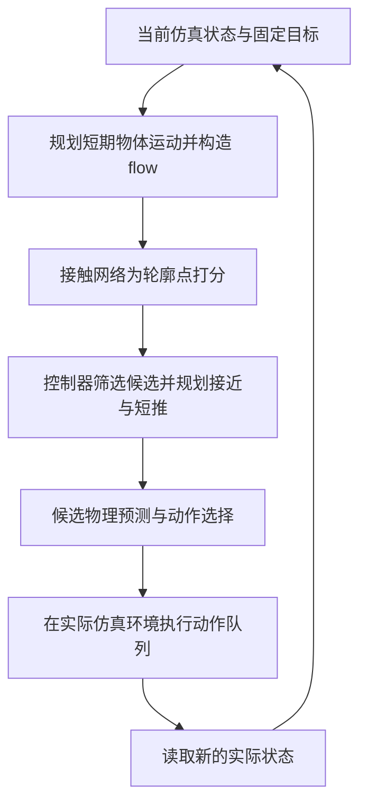
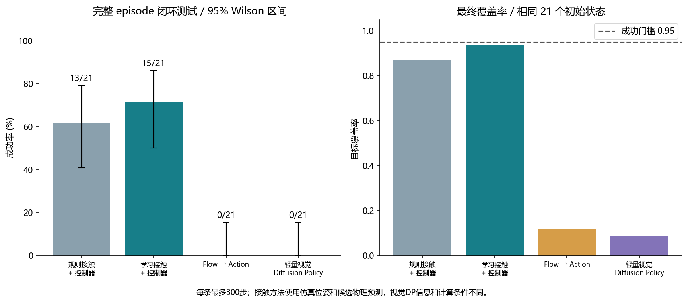

# 项目详解：原本要完成什么，最终实现了什么

本文面向第一次接触本项目的同学和汇报听众，解释研究问题、实现过程、实验结果及结论边界。它对照最初的四阶段任务，依据截至 **2026-10-22** 保存的代码、模型和实验记录编写。本次新增的是项目说明，没有重新训练模型，也没有修改已有实验数字。

**当前已经完成的是：在二维 PushT 中，搭建并实际运行了“数据回放与接触重建 → flow 条件接触预测 → 独立控制器 → 闭环推动 → 对照评测”的研究原型。**

**当前尚未完成的是：证明该方法能够跨不同机器人本体迁移，或在真实机器人、不同物体及复杂障碍条件下可靠工作。** 题目中的“面向跨本体”描述研究方向，不能直接写成已经实现的成果。

快速入口：[项目首页](../README.md) · [实验导航](EXPERIMENT_INDEX.md) · [另一台电脑如何运行](REPRODUCING.md) · [实验报告 PDF](../artifacts/stages234/report.pdf) · [模型与完整证据附件](https://github.com/Nogeomos/flow-contact-pusht/releases/tag/v1.0.0-experiments)

## 1. 我们究竟想研究什么

### 1.1 从“机器人怎么动”转向“物体需要怎么动”

假设桌面上有一个 T 形物体，我们希望它平移并旋转到目标区域。直接学习动作的方法，会尝试根据当前观测输出推杆接下来移动到哪里。这样的动作与执行器的形状、运动限制、坐标表示密切相关；换一个机器人，原来的动作未必还能使用。

本项目尝试增加一个中间层：先描述**物体希望发生的短期运动**，再预测**物体上哪些位置值得尝试接触**，最后交给针对执行器编写的控制器生成动作。

可以把研究假设表述为：

> 相比把物体运动直接映射为执行器动作，“物体运动 → 物体接触区域”可能是更容易解释、也更有潜力复用于不同执行器的中间表示。

这是需要通过实验逐步检验的假设。采用接触中间表示，本身不等于已经获得跨本体泛化能力。

### 1.2 本轮的具体问题

本轮先把问题限制在二维 PushT：固定 T 形物体、圆形推杆、固定仿真物理和目标设定。我们关心四件事：

1. **数据能否构建？** 从公开示范中核验动作与观测，回放并重建物体轨迹和实际接触，而不是假设数据已经有接触标签。
2. **接触能否预测？** 给定当前几何和未来短期物体运动，网络能否在固定编号的轮廓点上预测与示范接触接近的位置？
3. **预测能否用于控制？** 在没有示范未来信息的自主执行中，用目标构造 flow，再把接触预测交给独立控制器，能否把物体推向目标？
4. **效果来自哪里？** 与规则选点、直接动作预测、视觉扩散策略比较，分析接触模型、flow 输入和控制器各自的作用，以及失败和限制。

第一、二项主要检验数据和学习问题；第三项检验完整系统；第四项决定我们能对结果作出多强的解释。

### 1.3 什么才算完成这次课程项目

“完成”有两个不同层次：

| 层次 | 应当交付什么 | 本轮状态 |
|---|---|---|
| 工程与实验交付 | 代码能运行；数据和标签可检查；训练真实执行；测试、失败案例、版本和复现步骤可追踪 | 已完成本轮二维原型及四阶段实验流程 |
| 研究结论 | 方法是否稳定优于对照、是否跨本体、是否对复杂场景可靠 | 部分问题获得证据，部分仍未解决，不能统一写成“全部证明” |

例如，视觉基线真实训练并测试得到 0/21，意味着这项对照实验已经执行，但不意味着视觉控制目标已经实现。主模型成功 15/21，意味着系统在部分测试场景有效，也不等于已经可靠解决全部 PushT 场景。

## 2. 先弄清楚几个容易混淆的概念

### 2.1 flow 是物体点的运动，不是推杆动作

把 T 形物体轮廓上的固定点记为 $p_i$。若当前时刻为 $t$，未来第 $k$ 步的世界坐标位移为：

$$
\Delta p_{i,k}=p_{t+k,i}-p_{t,i},\qquad k=1,\ldots,8.
$$

一组点的这些位移，就描述了物体希望怎样平移、旋转。本项目使用的 flow 是这类由物体位姿计算出的材料点运动；本轮没有训练从两张 RGB 图像估计稠密光流的视觉网络。

网络实际接收的是：把上述位移转到**当前时刻物体的局部坐标系**，再除以固定尺度 30。所有未来步共用当前坐标系，而且是相对当前时刻的累计位移，不是相邻帧位移。

本轮控制频率为 10 Hz，8 步描述约 0.8 秒的期望物体运动。它没有直接告诉推杆从哪里绕行、接触多久或输出什么力。

### 2.2 接触位置不是完整动作

“接触 T 形物体的左侧某一点”仍然缺少执行所需的信息：推杆如何到达那里、从什么方向推、推多远、持续多久，以及下一次何时重新规划。

因此，模型只给候选位置打分；控制器负责把候选位置变成一段可执行的推杆目标序列；仿真器通过碰撞产生物体的实际响应。三个环节的职责不同。

| 信息 | 在本项目中的含义 | 不能把它当成什么 |
|---|---|---|
| flow | 希望物体材料点发生的短期位移 | 推杆动作、推力命令 |
| 接触标签 | 示范回放中实际出现过的几何接触区域 | 最优接触、成功概率 |
| 接触分数 | 网络对候选点的排序依据 | 已校准概率、可达性保证 |
| 动作 | 推杆中心在世界坐标中的绝对目标位置 | 推杆已经到达的位置、物体目标位姿 |
| 仿真执行轨迹 | 环境在这些动作下真实计算得到的运动 | 网络直接指定的物体轨迹 |

### 2.3 Gym 与物理引擎分别做什么

Gymnasium 提供环境交互接口，例如初始化、执行动作、读取观测；本项目的 PushT 环境利用 Pymunk 计算碰撞和刚体运动。物体受到推杆和墙体接触后怎样移动，由物理仿真决定。

因此可以改变初始条件，观察同一个模型在新条件下如何推动。但是“能在仿真里测试新情况”与“模型已经适应所有新情况”是两回事。新目标、不同物体、不同推杆和墙角条件，都需要各自的测试协议。

## 3. 四个阶段：原定任务与实际完成情况

最初按约八周、每两周一次汇报安排四个阶段。下表按研究逻辑对照任务，不表示这些阶段实际各花费了两周。

| 阶段 | 原定需要完成 | 本轮实际实现 | 验收时应怎样表述 |
|---|---|---|---|
| 第一阶段：环境与数据 | 原生 Windows 环境、官方资源核验、完整示范回放、编号点和接触可视化、人工短推 | 建立独立环境；下载固定版本；核验观测/动作；完成子步碰撞记录、可视化和确定性推动演示 | 环境、坐标、数据和控制接口已经运行验证；人工推动不是模型学习成果 |
| 第二阶段：模型学习 | 构建训练窗口，训练 flow 条件接触模型；比较点数、标签和时序表示 | 完整示范先划分后切窗；训练接触/动作模型和离线消融；保留权重、配置、训练曲线与测试预测 | 模型能够拟合重建的示范接触；离线指标不能替代闭环成功率 |
| 第三阶段：闭环控制 | 把接触预测接入独立控制器，从目标生成 flow，执行并重新规划 | 实现候选排序、接近路径、短推、候选物理预测和重新规划；规则与学习接触共用控制器 | 已形成能够自主运行的推动系统，但部分测试失败，墙体安全尚不完整 |
| 第四阶段：对照与分析 | 比较视觉 DP、flow→action 和简单规则，分析失败并形成材料 | 四方法完整测试；三个接触训练种子；无 flow 补充诊断；图表、PDF、代码、附件及新进程复验 | 对照已执行，正负结果都保留；轻量 DP 不等于完整论文复现 |

下面分别解释这些阶段具体做了什么。

## 4. 第一阶段：把数据和仿真变成可信的实验起点

### 4.1 原始数据确实提供了什么

采用固定版本的公开 `lerobot/pusht` 数据，共 **206 条示范、25,650 帧**。核验内容包括图像、时间、实际推杆位置、动作目标和示范边界；原始数据没有直接提供本项目所需的物体位姿、64 点轮廓或接触真值。

推杆实际位置与动作指令不同。动作是希望推杆中心追踪到的绝对坐标，环境内部通过控制更新其连续运动。直接把动作坐标当成该帧推杆实际中心，会同时破坏接触判断和时间对齐。

物体初始状态按已核验的 episode 初始化规则生成，再在固定环境中执行示范动作。回放与原始视频、推杆观测进行比较，用来检查该重建方案是否与示范一致。它仍然依赖仿真和初始化假设，没有独立的物体位姿/接触真值来证明逐点无误。

证据：[资源版本与 SHA256](../resource_manifest.json)、[回放比较记录](../artifacts/stage1/replay_validation.json)、[数据审计](../artifacts/stage1/data_audit.json)。

### 4.2 固定编号轮廓点是我们构建的表示

在物体局部坐标中沿外轮廓按弧长采样，主设置取 64 点。每个编号始终指向物体上的同一材料位置。物体移动后，按刚体变换得到世界坐标：

$$
p_i^{\mathrm{world}}=R(\theta)p_i^{\mathrm{local}}+t.
$$

这里的 $t$ 是仿真刚体局部原点的世界位置，**不是质心位置**；本物体的局部质心为 $(0,45)$。坐标 x 向右、y 向下，角度用弧度；长度是仿真世界单位，不是米，也不是 96×96 图像的像素单位。

64 是设计选择，不是数据集已经标注的 64 个点。后续又用 32 和 128 点做了离线比较。

### 4.3 接触来自碰撞记录，不能凭“最近”强行造标签

每个 0.1 秒控制周期包含 10 个 0.01 秒物理子步。程序收集子步中的推杆—物体碰撞点、法向及相关物理信息，然后把接触位置变到物体局部坐标，再映射到固定轮廓点。

环境核验还记录了实际生效的质量、惯量、摩擦、空间阻尼和步长，而不是只根据配置变量名猜测其含义。相同动作的效果依赖这些参数，本轮结论对应固定版本与固定物理设置；记录见[第一阶段验收说明](STAGE1_RECORD_2026-10-22.md)。

没有接触时标签全零；不能因为某个点距离推杆最近就给它正标签。T 形物体由多个形状组成，内部拼接缝不属于外轮廓；已识别的这类无效接触区间会从训练窗口中排除。几何接触也不等于一定产生有效推动，零冲量的接触不能作为成功推动证据。

逐帧约定是：`states[t]` 在 `actions[t]` 执行前；该动作对应的接触累计其十个物理子步。接触标签、动作和状态不能错开一帧。

### 4.4 实际得到的第一阶段与全量数据结果

| 检查范围 | 实际记录 | 如何理解 |
|---|---|---|
| 第一阶段重新验收的 3 条示范 | 420 帧，可见物体掩码平均 IoU 0.957751 | 小批量流程验收，与后续全量结果范围不同 |
| 全量 206 条示范 | 25,650 帧，可见物体掩码平均 IoU 约 0.960807 | 支持图像与回放总体对齐；不是位姿误差，也不是接触准确率 |
| 全量推杆位置比较 | 最大位置误差约 $2.14\times10^{-5}$ 世界单位 | 检查实际推杆轨迹与原始观测的一致性 |
| 全量接触重建 | 119,158 条物理子步接触点记录 | 是点事件数，不是 119,158 个独立训练样本 |
| 人工简单推动 | 70 步；质心移动约 47.90 单位、转角约 18.45° | 验证接近、推动、坐标和物理执行接口 |
| 简单推动复跑 | 两个独立进程的全部 16 个保存数组相同 | 在相同初始条件和环境下具有可重复性 |

原视频存在压缩、遮挡等因素，掩码 IoU 不是一个无误差的物体状态真值。我们把这批标签称为**经过回放一致性检查的仿真重建标签**。

可直接查看：[接触标签图片](../artifacts/stage1/contact_sample.png)、[无接触样本](../artifacts/stage1/no_contact_sample.png)、[人工推动动画](../artifacts/stage1/simple_push.gif)。字段细节见[第一阶段数据说明](STAGE1_DATA_SCHEMA.md)。

## 5. 第二阶段：我们训练了一个什么模型

### 5.1 数据怎样分组，为什么不能随机打散帧

先按完整示范划分 **164 / 21 / 21** 条训练、验证和测试，再在各组内部构造窗口。这样同一条示范中高度相似的相邻帧不会分别落入训练和测试。

每个接触训练窗口包含 9 个状态和 8 个动作/接触区间。排除没有原视频端点的最后区间及已识别的无效接触区间后，得到：

| 分组 | 完整示范数 | 8 步训练/评估窗口数 |
|---|---:|---:|
| 训练 | 164 | 19,130 |
| 验证 | 21 | 2,589 |
| 测试 | 21 | 2,281 |
| 合计 | 206 | 24,000 |

测试窗口中，未来八个区间内有接触的为 1,497 个，无接触的为 784 个。重叠窗口可以用于监督学习，但不能被当成数千个独立闭环试验。

冻结的划分和窗口清单分别见 [splits.json](../data/derived/splits.json) 与 [windows.json](../data/derived/windows.json)。

### 5.2 输入、输出和网络结构

对每个候选点，主模型输入两部分信息：

| 输入 | 单点维数 | 内容 |
|---|---:|---|
| 当前几何 | 13 | 点的局部位置、局部内法向、相对推杆位移及距离、推杆与物体原点的绝对世界坐标、角度的正余弦 |
| 短期物体运动 | $8\times2=16$ | 该点未来 8 步的累计局部位移 |
| 合计 | 29 | 13 维不是整个模型输入的全部维数 |

主模型将每点的 29 维向量送入共享 MLP（29→96→96），再对全部点的特征做全局最大池化。每个点的特征与全局特征拼接后，通过 192→96→1 的点预测头生成一个分数。另外有一个全局 presence 辅助输出，预测未来窗口是否出现接触。

主模型的 sequence 方式是把 8 步 flow 展平输入 MLP；它不是 Transformer，也不是循环网络。GRU 是另行训练的时序消融模型。

模型使用了推杆当前位置和绝对场景位置，因此不能称为已经实现了纯粹“与执行器无关”的表示。未来要验证跨本体，需要专门设计输入消融和迁移实验。

### 5.3 模型到底在学习什么标签

把未来八个控制区间内的外轮廓接触点，统一转换为物体自身局部坐标，组成集合 $\mathcal C_t$。对第 $i$ 个轮廓点，定义到该集合的最小距离 $d_i$。有接触时软标签为：

$$
y_i=\exp\left(-\frac{d_i^2}{2\cdot5^2}\right),
\qquad
d_i=\min_{c\in\mathcal C_t}\|p_i^{\mathrm{local}}-c\|_2.
$$

没有接触时，所有 $y_i$ 都为零。软标签允许接触附近的一小段轮廓获得连续监督，不把一个物理接触强制压缩成唯一离散点。训练使用加权二元交叉熵及辅助 presence 任务。

具体损失为：

$$
L=\operatorname{BCEWithLogits}_{\mathrm{pos\_weight}=5}(z,y)
  +0.25\operatorname{BCEWithLogits}\bigl(z_{\mathrm{presence}},\mathbf 1[\mathcal C_t\ne\varnothing]\bigr).
$$

其中 $z$ 是逐点的原始网络输出，BCEWithLogits 在内部结合 sigmoid 与二元交叉熵计算，presence 表示整个未来窗口是否出现接触。各点分别接受监督，允许多个接触区域同时为正；没有强制只能选出唯一正确点。由于训练使用加权损失，sigmoid 后的数值没有经过成功概率校准。

学习阶段采用示范监督学习，依靠重建接触或示范动作训练；环境用于回放、候选预测和闭环评测。本轮没有开展基于任务奖励的强化学习。

这里有一个关键限制：**标签是未来八个区间接触位置的并集，保留“出现在哪里”，不保留“先后顺序和具体时间”。** 因此输出不是完整接触计划，也不能解释为“当前立即触碰这个点必然正确”。在线控制器只使用点分数排序，尚未使用 presence 输出决定停止或暂缓推动。

### 5.4 已经训练和比较了哪些版本

| 检查点/配置 | 要回答的问题 | 本轮完成范围 |
|---|---|---|
| `contact_main` | 64 点、软标签、完整 8 步 flow 的主模型能否工作 | 离线评估和完整闭环测试 |
| `contact_seed1`、`contact_seed2` | 同一配置换训练随机种子，结果是否波动 | 离线评估和完整闭环测试 |
| `contact_32`、`contact_128` | 候选点密度如何影响定位误差 | 离线比较，未完成对应闭环比较 |
| `contact_hard` | 硬标签与软邻域标签的差别 | 离线比较 |
| `contact_endpoint` | 只保留末端位移，是否足以描述期望运动 | 离线比较 |
| `contact_gru` | 用循环网络编码时序 flow 的效果 | 离线比较 |
| `contact_no_flow` | 不提供 flow，仅用当前几何能做到什么 | 离线比较；主试验后的补充闭环诊断 |
| `flow_action` | 相同类型的几何与 flow 能否直接预测动作 | 离线评估和完整闭环测试 |
| `visual_dp` | 图像条件扩散动作策略在本次预算下的效果 | 轻量适配训练、离线评估和完整闭环测试 |

前十个接触/动作检查点各训练 40 轮；视觉 DP 单独训练 60 轮。保存的最佳权重按验证集指标选择，不依据测试成功率挑选。总计有 11 个 best 检查点，不是 11 种完全独立的研究方法。

### 5.5 离线模型取得了什么结果

主接触模型的完整测试记录为：

| 指标 | 实测值 | 统计对象/含义 |
|---|---:|---|
| top-1 预测点距离回放重建的未来接触集合 ≤10 | 93.92% | 仅在 1,497 个有接触测试窗口计算 |
| top-5 中存在距离 ≤10 的点 | 98.26% | 提供多个候选可提高接触定位覆盖 |
| top-1 平均接触距离 | 3.05985 世界单位 | 不是动作误差，也不是物体终态误差 |
| presence F1 | 0.99094 | 区分未来窗口有无接触的辅助指标 |
| 无接触窗口误报率 | 0.7653% | 在 784 个无接触窗口上计算 |

这支持“在给定示范未来运动条件时，可以较好地拟合重建接触”的结论。**不能把 93.92% 写成推动任务成功率。**

无 flow 模型的离线 top-1 为 90.71%，说明当前几何本身已经提供很强的接触先验；其无接触误报率约 15.05%，明显不同于主模型。不能把主模型所有能力都归因于 flow。

32、64、128 点的平均接触距离分别约为 3.477、3.060、2.862。但候选点变密以后，即使拥有真实接触信息，也更容易找到接近它的采样点；相应的离散采样误差下限约为 1.127、0.371、0.121。因而“128 点绝对误差更小”不等于网络学习能力全面更强。也没有证据表明软标签一定优于硬标签，或主模型一定优于 GRU。

证据：[主模型离线结果](../artifacts/stages234/contact_main/test_metrics.json)、[完整消融统计](../artifacts/stages234/statistical_analysis.json)、[实际预测可视化](../artifacts/stages234/figures/contact_predictions.png)、[九个可检查样本清单](../artifacts/stages234/stage2_samples/manifest.json)。

## 6. 第三阶段：接触预测如何变成真正的推动

### 6.1 离线与在线必须使用不同来源的 flow

训练时，我们知道示范后来实际怎样移动，所以可以用示范未来位姿构造监督条件。自主测试时，机器人没有这些未来信息，必须根据当前状态与目标，自己构造短期的期望运动。

闭环程序只使用测试 episode ID 生成初始条件；不读取该示范之后的动作、未来轨迹和接触。在线 flow 来自当前状态和目标，而不是“偷看答案”。同时，本轮接触控制器使用仿真提供的准确物体位姿，尚未实现从图像估计物体位姿的前端。

### 6.2 控制器负责的具体工作

控制器在每轮计划开始时计算有界的短期目标位姿变化，再生成 8 步轮廓点 flow。

构造 flow 时，先从 body origin 和局部质心计算当前物体质心，再朝目标质心移动；一次规划的平移限制为最多 24 世界单位，最短角度变化限制在 $\pm0.24$ 弧度内，并均匀分成 8 步。这样得到的是短期运动意图，没有提前保证物理上可以实现。随后进行以下控制步骤：

1. 用学习分数或规则分数对轮廓点排序，过滤不合格的接近位置，保留最多 8 个彼此分离的候选。
2. 根据轮廓法向构造接触前的推杆位置，并规划绕开 T 形物体的接近路径。
3. 对各候选尝试预设的短推方案，而不是只输出一个没有方向的接触点。
4. 在复制的物理世界中模拟候选方案，比较预测终态与目标轮廓的误差，并对接近动作数施加代价。
5. 选出动作队列，在真正用于评测的仿真环境中执行，读取实际状态后再次规划。

当前实现中的主要控制参数为：

| 项目 | 实际设置 |
|---|---|
| 候选数量与间距 | 最多8点；局部欧氏距离至少20 |
| 预接触中心 | 轮廓点沿外侧偏移19；推杆半径15 |
| 接近避障 | T形轮廓膨胀18，利用可视图规划路径 |
| 接近目标轨迹 | 按名义速度不超过120世界单位/秒生成；不等于保证实际速度恒定 |
| 接近后保持 | 3个控制周期 |
| 短推方向 | 沿计划起点所选轮廓点的世界内法向；队列执行中不随物体重新计算 |
| 短推候选 | 目标移动长度12或40，分别分成8个动作 |
| 推动后保持 | 2个控制周期 |
| 最终方案选择 | 预测终态轮廓点RMSE，加上 $0.035\times$ 接近阶段动作数的代价；该计数包含接近后3步保持 |

因此一次计划最多预测 $8\times2=16$ 条动作序列。这里的“长度12或40”描述控制器生成的推杆目标变化，并不保证物体实际也移动相同距离。

**网络分数的直接作用是候选排序和筛选。** 最终候选代价依据预测终态的轮廓点 RMSE 与接近动作成本计算，网络分数不是最终代价项。因此主系统的效果是学习、几何路径规划和额外物理预测共同产生的。

执行频率也需要准确描述：环境每 0.1 秒接收一次动作，但当前控制器完成一段“接近—保持—短推—保持”队列后才重新选择接触点。不能写成每个控制步都重新调用网络，也不能把 0.8 秒 flow 窗口当成固定的整个计划周期。

候选物理预测没有复制求解器全部内部缓存，属于近似预测；已有检查中，接触情形单步位置最大差约 0.02865 世界单位。最终成功数来自实际执行轨迹，没有用预测轨迹代替实验结果。

### 6.3 模型与控制器的贡献怎样区分

| 组件 | 当前主要贡献 | 不能归到它名下的能力 |
|---|---|---|
| 接触模型 | 利用几何和 flow，为候选接触位置提供排序 | 路径规划、完整推杆动作、墙体安全保证 |
| 独立控制器 | 接近、短推参数、候选预测、动作执行与重新规划 | 接触标签最优性的证明、跨本体泛化证明 |
| 物理仿真 | 计算碰撞及物体真实响应，提供可重复实验场景 | 自动训练策略、保证策略成功 |

当前最干净的对照是“学习接触 + 同一控制器”对比“规则接触 + 同一控制器”，因为主要变化是候选排序方式。它仍不能单独回答“如果没有物理搜索，网络会有多好”。

代码：[接触与动作模型](../research/contact_learning.py)、[独立控制器](../research/controller.py)、[闭环评估](../research/evaluate_closed_loop.py)。

## 7. 第四阶段：最终结果是什么，能说明什么

### 7.1 统一测试条件与指标

四个主方法使用同一组 **21 个未用于训练的初始场景**，每条最多 300 次实际控制动作，即至多 30 秒仿真控制时间。这不是程序的墙钟运行时间，候选搜索还会使用额外计算。

任务覆盖率定义为：

$$
\mathrm{coverage}=\frac{\mathrm{area}(\text{当前物体}\cap\text{目标物体})}{\mathrm{area}(\text{目标物体})}.
$$

执行过程中覆盖率达到 0.95 记成功，并按共同规则停止；另保存原环境严格大于 0.95 的判据。这个指标与前面比较视频轮廓用的掩码 IoU 不同。

本轮目标设定固定。测试证明的是这些保留初始条件下的表现，不能据此声称任意新目标、不同形状和分布外状态都已验证。

### 7.2 四个主方法的实际结果

| 方法 | 输入及额外计算 | 成功数 | 成功率 | 平均最终覆盖率 | 平均最大覆盖率 |
|---|---|---:|---:|---:|---:|
| 规则接触 + 独立控制器 | 准确几何状态；路径规划与候选物理预测 | 13/21 | 61.90% | 0.8712 | 0.8833 |
| 学习接触 + 同一控制器，主种子 0 | 准确几何状态、规划 flow；同类控制与预测 | 15/21 | 71.43% | 0.9375 | 0.9430 |
| Flow → action | 几何与规划 flow；直接动作网络，无上述候选搜索 | 0/21 | 0.00% | 0.1172 | 0.1743 |
| 轻量视觉 Diffusion Policy | 两帧 RGB 与推杆实际位置；扩散动作序列，无上述候选搜索 | 0/21 | 0.00% | 0.0869 | 0.3083 |

可以查看[同一初始场景的四方法动画](../artifacts/stages234/figures/comparison_episode_12.gif)。动画只用于直观展示，结论应依据全部 21 条轨迹，而不是只看一条成功案例。

### 7.3 学习接触是否已经显著优于规则

主模型比规则多成功 2 条，成功率相差约 9.52 个百分点。但两者是相同场景的配对比较：主模型独有成功 3 条，规则独有成功 1 条。确切双侧 McNemar 检验为 **p=0.625**，目前不能宣称成功率显著提升。

主模型成功率的 Wilson 95% 区间约为 50.04%–86.19%，规则为 40.88%–79.25%，反映出 21 个场景带来的不确定性。主模型平均终态覆盖率高约 0.06638，配对场景重采样区间约为 [0.01778, 0.12529]；该估计只针对这两个已固定模型和这组场景，不包括训练种子等额外不确定性。

另外两个接触训练种子分别成功 12/21 和 15/21。三个种子的成功率均值为 66.67%，样本标准差为 8.25 个百分点。它们复用了同一组 21 个场景，不能合并宣传为 63 个独立测试，也不能事后挑最好的种子作为主结果。

### 7.4 flow 有没有起作用

在主试验之后，我们追加了不提供 flow 的闭环诊断：保持同一控制器和初始条件，单种子无 flow 模型成功 **6/21**。主模型相对它新增成功 9 条、没有失去成功，探索性配对检验 p=0.00390625。

这支持“在当前设置中 flow 输入有帮助”，但仍是事后提出的单种子诊断，且改变输入也改变了网络输入层参数量。它不是跨不同数据分布、多种执行器都成立的定理，也不能替代预先确定的四方法主表。

### 7.5 两个 0/21 应怎样解释

**Flow → action：** 该网络可以学习示范动作的离线映射，但自主执行未达成功阈值。其中 9 条测试全程没有接触、物体没有运动；这部分案例没有完成有效推动。对其余失败不能套用同一个原因，也不能把本轮负结果推广到所有 flow→action 方法。

**视觉 Diffusion Policy：** 实际完成了 60 轮、19,200 次更新，使用约 580 万参数的轻量模型，训练循环约 28.04 分钟。按验证去噪误差选择第 10 轮权重；后期验证误差上升，出现过拟合迹象。

它采用官方 `ConditionalUnet1D` 源码，但图像编码器、网络宽度、训练预算和推理方式经过适配：两帧输入、16 步预测、执行 8 步、DDPM 100 步训练、DDIM 20 步推理。因此不能把它写成官方完整 Diffusion Policy 结果的复现。

该视觉策略在完整离线测试中，动作序列误差约 46.57 世界单位，低于保持当前推杆位置的 54.87，但闭环仍为 0/21。所有测试都发生过接触，因此不能归结为“完全碰不到物体”；不少轨迹达到较好位置后又退化。已进行图像通道、坐标缩放和时间索引检查，没有发现相应接口错误，但没有据此证明失败的唯一原因。

另外，视觉策略没有接触方法使用的准确物体位姿，直接动作和视觉策略也没有候选仿真搜索。**相同真实动作预算不等于相同输入信息和计算预算。** 当前结果不能证明接触模型普遍优于充分训练的视觉策略。

证据：[完整统计与配对检验](../artifacts/stages234/statistical_analysis.json)、[失败分析](STAGES234_LIMITATIONS_AND_FAILURES.md)、[视觉 DP 实现与实际训练记录说明](../research/VISUAL_DP.md)。

## 8. 墙体、墙角和推杆实体：当前到底考虑到了什么

这是理解当前系统能力边界的重要部分。

### 8.1 环境有墙，推杆也有碰撞形状

场景有四面静态墙，T 形物体是动态刚体，会与墙碰撞。推杆是半径 15 的圆形碰撞体，必须与物体接触才能推动它；动作没有提供“在任意物体位置直接施加力”的接口。

但推杆被建模为 **kinematic（运动学）刚体**：运动由程序控制，不会因为碰撞反冲而被推回。已有探针验证，静态墙不能自动阻止推杆追踪到穿墙位置。它也没有真实机械臂的关节、连杆、力矩和可达工作空间限制。

所以它既不是“完全没有实体的任意施力工具”，也不是“已经满足真实机器人约束的机械臂”。

### 8.2 网络、规划器和控制器对墙体的处理不同

| 环节 | 当前实现 | 缺失部分 |
|---|---|---|
| 接触网络 | 输入包含绝对位置，可能利用固定场景中的位置先验 | 没有显式墙体几何、距离或可达性输入；改变墙体而保持现有输入不变，评分不会主动感知这个变化 |
| 期望 flow 规划 | 根据当前物体与目标产生短期运动 | 没有先把期望运动投影为避墙的可行运动 |
| 候选物理预测 | 会计算动态 T 形物体与墙的碰撞 | 不等于已经满足推杆本体的严格墙体约束 |
| 接近路径与边界 | 绕开膨胀后的 T 形物体，部分位置裁剪到 21..491 | 该范围不是完整圆形推杆的安全净空范围；没有可靠墙角恢复策略 |

墙内面是 7 和 504。半径 15 的推杆圆心至少应在 22..489 内，再留跟踪误差和额外裕量。现有 21..491 裁剪比这个要求宽，不能声称已经实现严格墙体安全。

### 8.3 已实际做的墙边诊断

| 补充场景 | 实际表现 | 结论范围 |
|---|---|---|
| 左墙附近 | 261 步成功，终态覆盖率 0.9570 | 这一具体初始条件能够处理 |
| 左上墙角 | 离开墙角，但 300 步终态覆盖率 0.9147，仍判失败 | 出角不等于完成任务，不能称可靠墙角脱困 |

对原测试保存的 10 Hz 状态做净空审计，规则和主接触方法没有观察到侵墙；Flow → action 的第 102 条场景有 37 个侵墙状态，最大侵入约 9.95 单位。只检查这些保存帧，不能保证所有物理子步安全。

这两条墙边诊断没有加入原 21 条测试的成功率，也没有用来修改原权重和控制器。若要实现“物体靠墙或卡住时可靠推动”，还需要可行 flow、推杆完整净空、子步约束检查、多阶段接触切换及专门的墙角测试集。

证据：[墙边诊断结果](../artifacts/wall_diagnostics/summary.json)、[墙边轨迹图片](../artifacts/wall_diagnostics/wall_cases.png)、[原测试帧级净空审计](../artifacts/wall_diagnostics/original_rollout_clearance_audit.json)。

## 9. 最后交付了什么，可以在哪里检查

| 交付内容 | 入口 | 可以检查什么 |
|---|---|---|
| 数据获取、检查、回放、标签与人工演示代码 | [scripts](../scripts) | 数据从哪里来、状态和接触如何重建 |
| 接触/动作/扩散模型及训练代码 | [research](../research) | 网络、监督、训练和评估具体实现 |
| 实验协议与字段定义 | [协议](STAGES234_PROTOCOL.md)、[阶段 2–4 字段](STAGES234_DATA_SCHEMA.md) | 哪些信息可用于训练，在线是否读取未来 |
| 图表、样本和完整统计摘要 | [artifacts/stages234](../artifacts/stages234) | 主结果、消融、失败、训练曲线与样本来源 |
| 两份阶段报告 | [前期 PDF](../artifacts/stage1/report.pdf)、[阶段 2–4 PDF](../artifacts/stages234/report.pdf) | 离线查看和汇报材料 |
| 11 个已训练模型 | [模型清单](../artifacts/models/manifest.json)、Release 中的 `models.zip` | 模型配置、原件与发布副本的哈希关系 |
| 完整实验记录及 206 条重建回放 | Release 中的 `evidence.zip` | 逐条轨迹、日志、离线预测与回放文件 |
| Windows 安装与恢复入口 | [REPRODUCING.md](REPRODUCING.md) | CPU/GPU 环境、资源获取、附件恢复和运行命令 |
| 版本和文件完整性 | [资源清单](../resource_manifest.json)、[发布清单](../artifacts/PUBLICATION_MANIFEST.json)、[附件清单](../artifacts/RELEASE_ASSETS.json) | 来源版本、文件范围和 SHA256 |

原始公开数据和上游源码按固定版本下载；Python 虚拟环境和大型视觉缓存不放入 Git。发布副本中已去掉本机用户路径；视觉 DP 检查点只处理内嵌路径元数据，数值张量经过逐项一致性验证。发布文件的哈希与历史原件哈希分开记录，不能互相冒用。

### 9.1 已经做过哪些复验

除了原训练和闭环实验，已完成以下检查：

- 四组原闭环结果在新进程重跑，共 84 条轨迹、756 个数组字段；除覆盖率最大约 $5.55\times10^{-16}$ 的浮点舍入差外，其余字段一致。这是复验，不是 84 个新独立场景。
- 在独立暂存目录重建全部 206 条回放，其 NPZ 与原记录逐字节一致；24,000 个窗口成员一致。
- 四种方法各完成 16 步 CPU 闭环运行检查；11 个发布模型全部能够加载。
- 发布版主接触与视觉 DP 的短程轨迹与原权重结果一致；附件恢复、文件冲突保护和校验流程经过实际运行。
- 首次 GitHub 发布后重新克隆，核验仓库文件和附件校验值。

这些检查复用了本机现有 Python 依赖，**没有在第二台物理电脑上实测，也没有重新安装全新的 CPU PyTorch 环境**。不能将“提供了安装步骤”说成“任意设备安装已经验证”。完整原验收与发布副本的文件完整性检查也是两个不同任务。

证据：[原实验验收](../artifacts/stages234/final_acceptance.json)、[移植与发布模型运行记录](../artifacts/portability/verification.json)。

## 10. 现在可以说已经实现什么，还不能说实现什么

| 表述 | 是否有本轮证据支持 | 更准确的说法 |
|---|---|---|
| 已完成 flow 条件接触预测和闭环操作原型 | 支持 | 二维固定 PushT 设置中，流程已经真实运行 |
| 模型能较好定位示范接触 | 有限定地支持 | 离线给定示范未来运动时，主模型在有接触窗口的 top-1 距离≤10比例为93.92% |
| 学习接触系统比规则多成功两个场景 | 支持 | 主种子15/21对规则13/21；成功率差异尚未显著 |
| 模型已经学到最优接触或成功概率 | 不支持 | 学到的是示范重建接触的评分与排序 |
| 接触网络单独完成了71.43%的推动任务 | 不支持 | 这是网络、路径规划和候选物理预测共同构成的系统成绩 |
| 接触方法普遍优于 Diffusion Policy | 不支持 | 当前轻量视觉适配失败；信息、架构和计算预算均不等同 |
| 已经完成跨本体操作 | 不支持 | 尚未更换执行器进行迁移测试，输入还含推杆状态 |
| 能可靠处理墙角和严格避免穿墙 | 不支持 | 只有两例补充诊断，控制约束仍不完整 |
| 已经实现端到端视觉接触操作或真实机械臂部署 | 不支持 | 主接触系统使用仿真准确物体位姿，未实现视觉位姿前端和真实机器人接口 |

这意味着本项目当前最扎实的成果是：**建立了一套可以检查、重复执行并揭示问题的接触学习实验系统，而且得到了明确的正结果、负结果和下一步研究问题。**

## 11. 如果继续研究，接下来具体需要完成什么

以下是后续工作建议，尚不是本轮已经完成的实验。原 21 条测试已经用于最终分析；后续修改应另行固定验证和测试用途，不能针对它们反复调参后仍称其为未见测试集。

| 优先事项 | 需要补做的实现/实验 | 怎样判断是否完成 |
|---|---|---|
| 分离网络与控制器的作用 | 在相同输入与物理搜索预算下，比较学习、规则、随机、固定排序，并改变候选数量 | 多种子、固定新场景下报告成功率与计算成本，说明学习排序究竟节省了多少搜索或带来多少收益 |
| 让 flow 更可执行 | 加入墙体/接触可达性，比较不同规划长度与方向；同一状态配不同目标，检查网络是否作出相应变化 | 统计不可行计划、运动误差、接触与成功，而不是只展示好看的预测箭头 |
| 完善墙体与墙角处理 | 加入圆形推杆完整净空、物理子步检查、接触切换和失败恢复 | 在预先固定的靠墙/角落场景集上报告侵墙、卡住、出角与最终成功四类指标 |
| 真正验证跨本体假设 | 改变推杆半径或执行器约束；尝试冻结接触模型，只调整控制器；与直接动作策略比较适配成本 | 清楚区分零样本迁移、少量适配和重新训练，报告多种执行器的完整结果 |
| 检查表示是否依赖特定场景 | 移除或改变绝对位置、推杆特征，增加目标变化和新的初始状态分布 | 在不同于训练设定的测试条件中评估，而不是只重复原21条 |
| 加强对照的公平性 | 增加同物体位姿输入的动作基线，或让各方法共享同一视觉状态估计前端；记录计算预算 | 明确比较的是表示、控制器还是感知能力，并同时报告成功率和计算量 |
| 弥补时序接触信息 | 从八步接触并集扩展到逐时刻接触或接触阶段；评估presence能否参与决策 | 检查是否减少无效接近、接触切换错误及目标附近反复推动 |
| 走向真实视觉与机器人 | 添加图像位姿估计、噪声/物理扰动、机械臂约束和实际硬件接口 | 先完成仿真扰动测试，再单独建立真实实验与安全验收；不能由二维结果直接推断 |

两人小组若继续推进，可以让一人侧重数据、标签、接触模型与离线分析，另一人侧重几何、控制器、物理约束与闭环评测；协议、测试划分、对照公平性和最终结论应共同审核。这是建议分工，不是对之前实际工作归属的记录。

## 12. 汇报时怎样讲清楚我们的工作

可以按四个问题组织展示：

1. **为什么这样做？** 物体运动和接触位置可能比特定执行器动作更容易复用，因此尝试把运动意图与执行控制分开。
2. **我们实际做了什么？** 核验公开示范、重建接触、训练 flow 条件模型，并接入独立控制器，完成四方法比较和失败分析。
3. **得到什么证据？** 主模型离线接触定位较好；完整系统在21条测试中成功15条，规则13条；轻量动作基线未成功，且比较存在输入和计算预算差异。
4. **还缺什么？** 尚未证明成功率稳定优于规则、跨本体迁移和复杂场景可靠性；下一步要分离控制器贡献、补齐物理约束并进行真正的迁移实验。

可用于汇报开场的完整表述是：

> 我们在二维 PushT 环境中研究了“希望物体怎样运动”能否转化为有用的接触位置预测。项目从公开示范的数据核验和接触重建开始，建立了固定轮廓点表示，训练了 flow 条件接触网络，并把它接入一个独立的路径规划与物理预测控制器。系统在21个固定测试初始条件中成功15个，规则选点在相同控制器下成功13个；当前样本尚不能证明成功率显著提升。我们同时完成了直接动作预测、轻量视觉扩散策略和多项消融，保留了负结果和墙体限制。本轮证明了这套二维研究流程能够运行并产生可检查的结果，跨机器人本体的泛化仍需要进一步实验。

所有数字应与本仓库的[统计记录](../artifacts/stages234/statistical_analysis.json)一起引用。演示动画用于帮助理解，未来计划用于说明方向，两者都不能代替已运行的实验结果。
